<picture>
  <source media="(prefers-color-scheme: dark)" srcset="brand/github/readme-banner-dark.svg">
  
</picture>

Tattlestone plugs into your car and tells you what it's been keeping quiet about.

## Why it exists

It started with a 2004 Chevy Silverado that kept going dead overnight. Something in the truck was still using power after it was locked up, and the usual way to find it is to pull fuses one at a time while watching a meter on the battery. Tattlestone came out of wanting the truck to just say what was wrong.

## What it does

Your truck has a bunch of small computers in it. One runs the engine and another runs the dashboard. They talk to each other all the time, and when something goes wrong they write down a code. Tattlestone reads what they say and shows it on your Mac.

- It checks the truck's health: battery voltage, the check engine light, and whether the emissions tests are ready.
- It shows live gauges while the engine runs, like speed, temperatures and how rich or lean the fuel mix is.
- It reads fault codes and tells you what they mean in plain words. It knows 371 codes for GM trucks of that era and about 9,500 general ones.
- It helps you hunt down a battery drain. It tracks the battery voltage over hours, shows which fuses on your truck are most likely to blame, and walks you through pulling them in order.
- It looks up recalls and service bulletins for your truck from NHTSA, and points out the ones that mention your codes.
- You can ask Claude about what you're seeing. It answers from Tattlestone's own code lists and NHTSA's records, and tells you which ones it used. You bring your own API key.
- It saves sessions, so you can compare today with last week, and it can turn one into a report.

## It only listens

Tattlestone reads from your truck and never changes anything in it. There's no button to clear codes, and the part of the app that talks to the truck refuses any command that would erase, reset or reprogram one of its computers. If you need to clear a code, use a regular scan tool.

## What it looks like

These come from the built-in pretend truck, so they show a 2004 Silverado that isn't real.

The health screen is the first place to look.

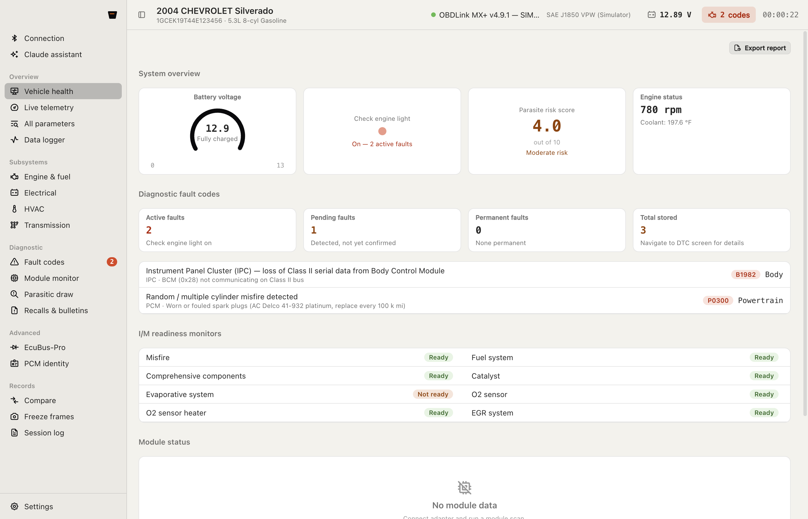

Live telemetry updates while the engine runs.

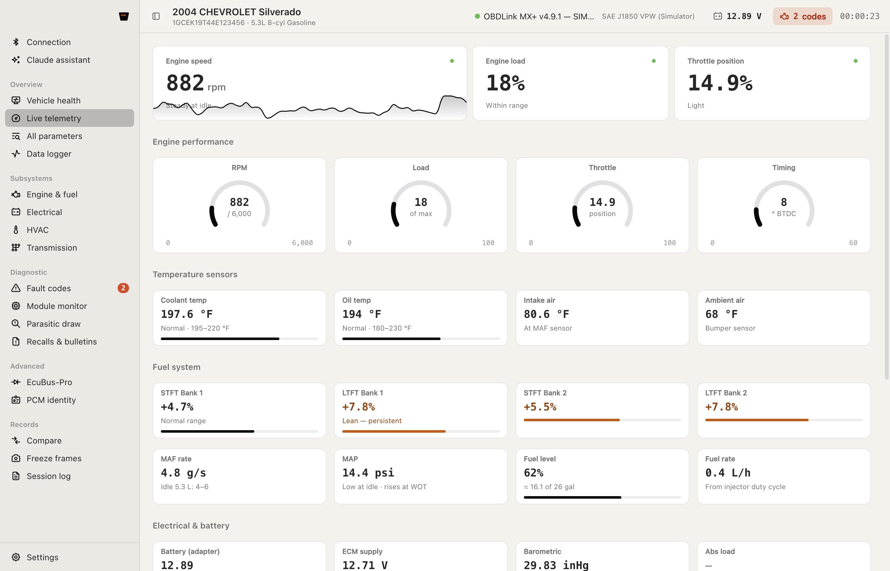

Fault codes, with what each one means.

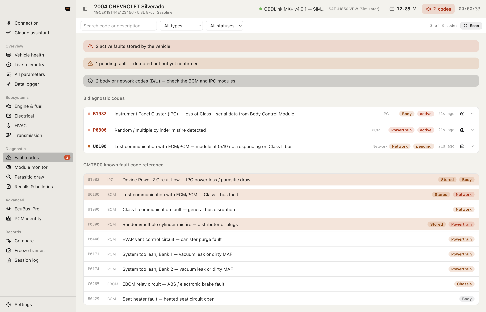

This is the battery drain screen.

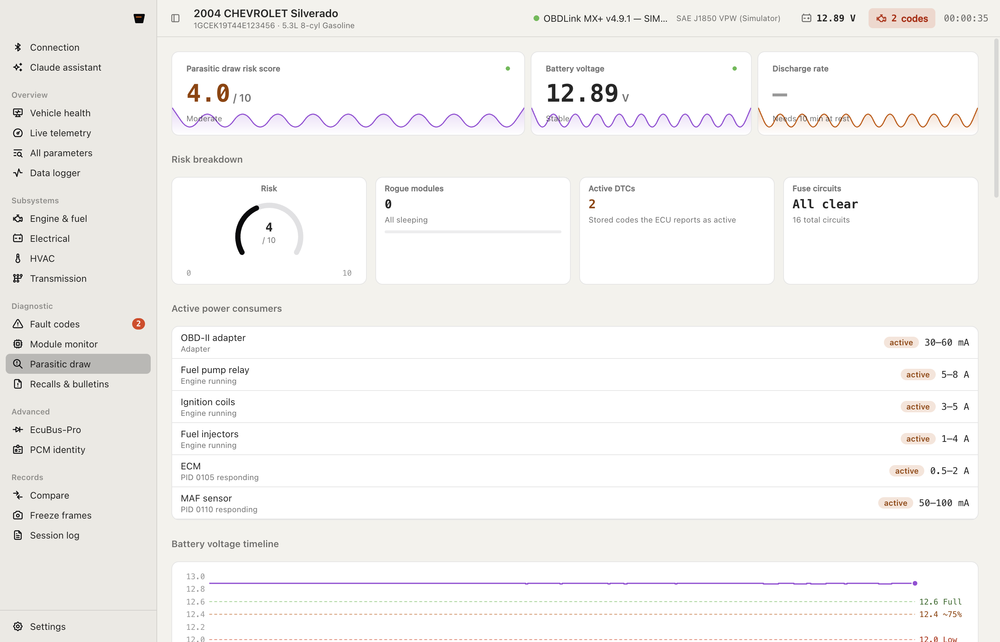

| | |
|---|---|
| 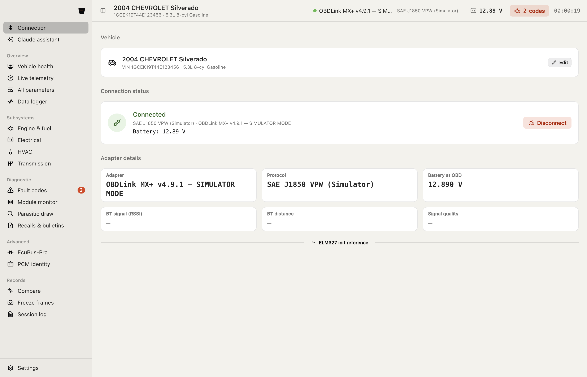 Connecting to an adapter | 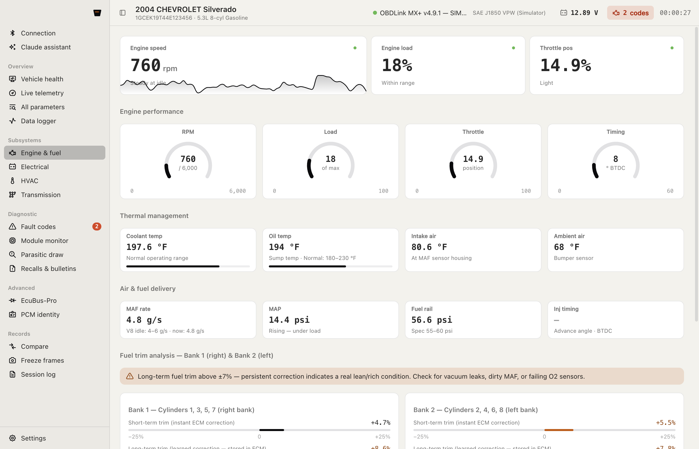 Engine and fuel detail |
| 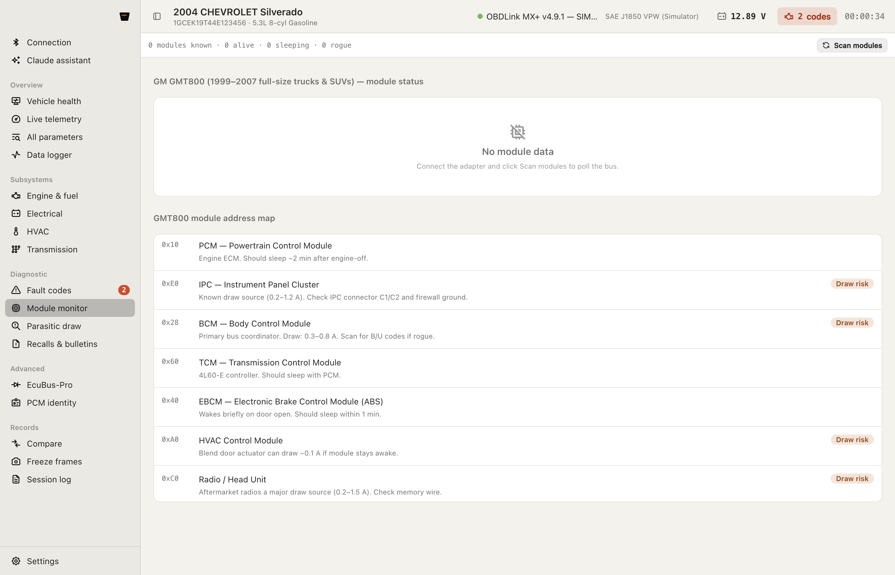 The truck's computers, by address | 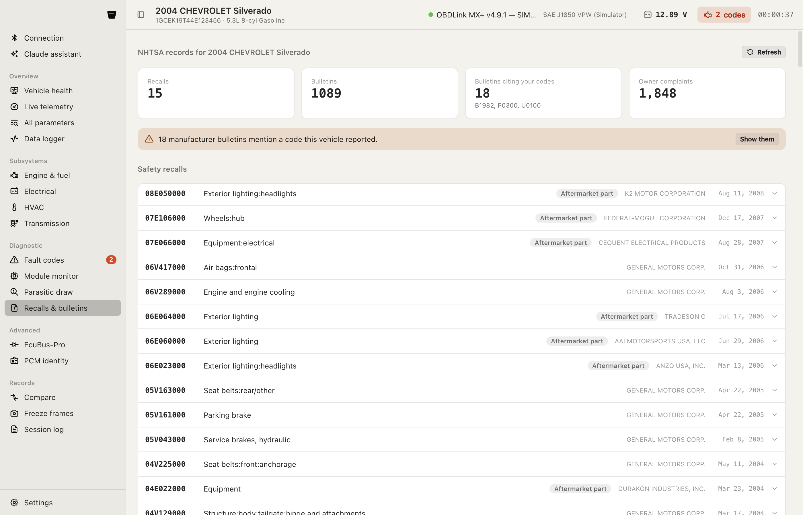 Recalls and bulletins from NHTSA |
| 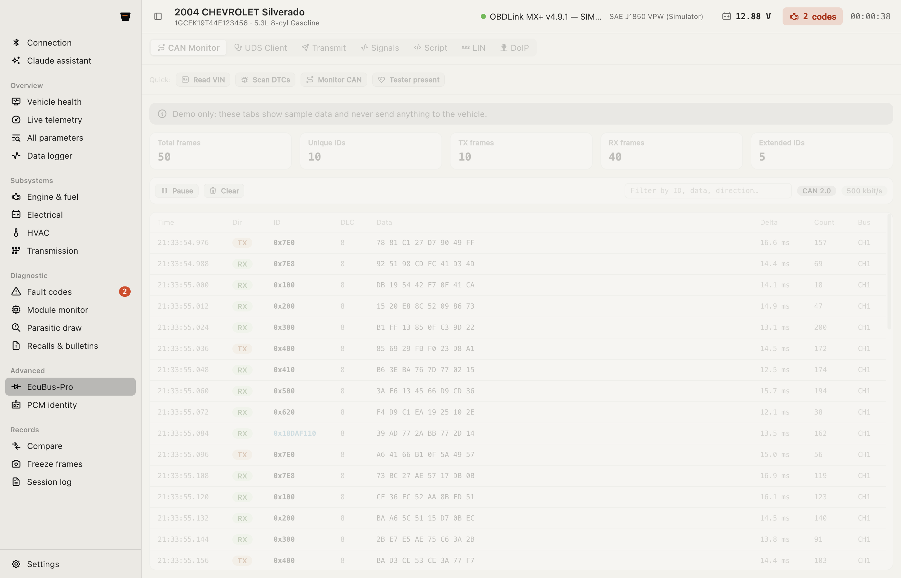 EcuBus-Pro (sample data for now) | 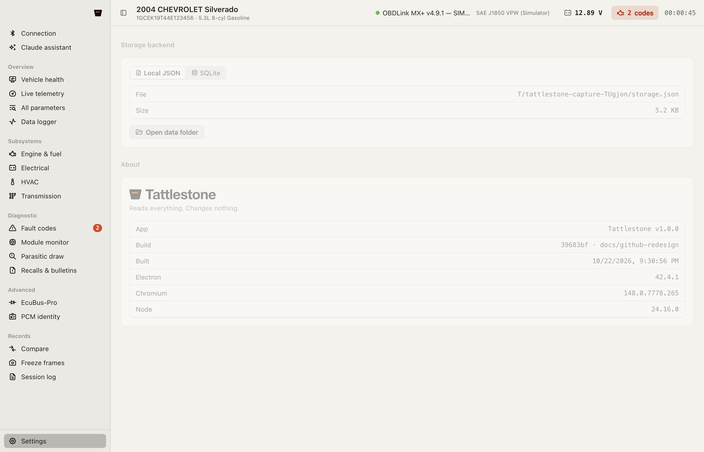 Settings |

## How the Arduino fits in

<picture>
  <source media="(prefers-color-scheme: dark)" srcset="brand/github/arduino-flow-dark.svg">
  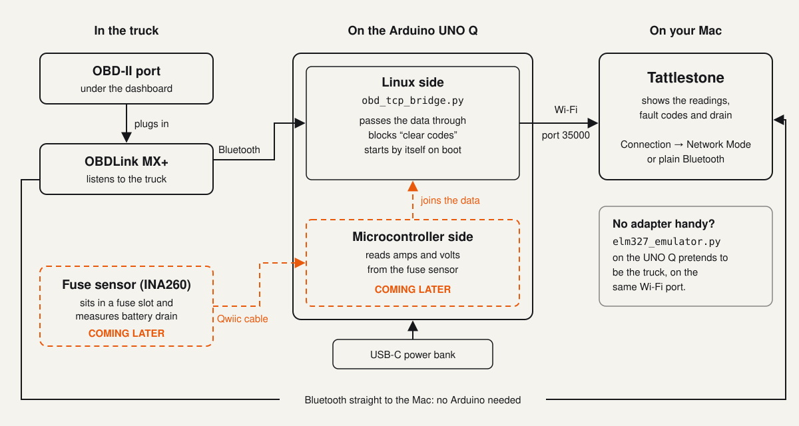
</picture>

You don't need an Arduino. Most of the time the adapter pairs with the Mac over Bluetooth, which is the line along the bottom.

Bluetooth only reaches a few metres, though, and a drain test runs overnight with the truck locked. So an Arduino UNO Q can sit in the cab instead, and your Mac can be anywhere on the same Wi-Fi.

1. The truck's computers talk on a wire that comes out at the OBD-II port under the dashboard.
2. The OBDLink adapter plugs into that port, listens, and sends what it hears over Bluetooth.
3. The UNO Q picks that up and passes it to your Mac over Wi-Fi. It also drops the standard clear-codes command (Mode 04) if anything sends one.
4. Tattlestone shows it the same way it would if the adapter were paired with the Mac.
5. Later, a small sensor on one fuse will measure the drain directly and send it the same way. That part isn't built yet.

The UNO Q can also pretend to be the truck, which is handy for testing the Wi-Fi link at your desk. Setup steps are in [docs/HARDWARE.md](docs/HARDWARE.md#network-mode-with-the-arduino-uno-q).

## Try it

You don't need a truck for this. You do need an Apple Silicon Mac with Node.js 22.12 or newer and the Xcode command line tools installed.

```bash
git clone https://github.com/jmjohns9/Tattlestone.git
cd Tattlestone/files
npm install
npm run install:app
```

1. Open Tattlestone from your Applications folder.
2. Go to **Connection** and click **Launch Emulator**. A pretend 2004 Silverado shows up, with its battery slowly sinking from 12.89 V.
3. Go to **Fault codes** and click **Scan**. It finds two stored codes and one pending.

## What you need for a real truck

- A Mac on macOS 13 or newer.
- An OBDLink MX+ adapter, about $110 to $135. Other ELM327 adapters work too, with fewer extras.
- The ignition turned on. The engine can stay off.

How to pair it and which adapters to avoid are in [docs/HARDWARE.md](docs/HARDWARE.md). Please don't read live data while you're driving.

## For developers

- [Building, running and testing](docs/DEVELOPING.md)
- [How the app is put together](docs/ARCHITECTURE.md)
- [Hardware and the UNO Q bridge](docs/HARDWARE.md)
- [Security and the read-only rules](docs/SECURITY.md)
- [What changed](CHANGELOG.md)

## Credits

- The GM PCM Mode 3C block IDs and request/response framing in `pcmDiagnostics.ts` are derived from **PcmHammer** (GPL-3.0): `Apps/PcmLibrary/Messages/BlockId.cs` and `Docs/Read_ID_Commands.txt`.
- PID decode formulas follow **SAE J1979**, and the GMT800 bus behaviour follows **SAE J1850 VPW**.
- The Claude assistant uses the [Anthropic API](https://docs.anthropic.com) through `@anthropic-ai/sdk`. You supply your own API key.
- Icons are from [Tabler Icons](https://tabler.io/icons) (MIT), bundled locally.
- Generic fault-code text comes from [OBDex](https://github.com/foerbsnavi/OBDex) (data CC0-1.0).
- Offline VIN decoding uses [@cardog/corgi](https://github.com/cardog-ai/corgi) (ISC), which bundles NHTSA's vPIC database.
- Recalls, bulletins, complaints and online VIN decoding come from [NHTSA](https://www.nhtsa.gov/nhtsa-datasets-and-apis) (US government, public domain).
